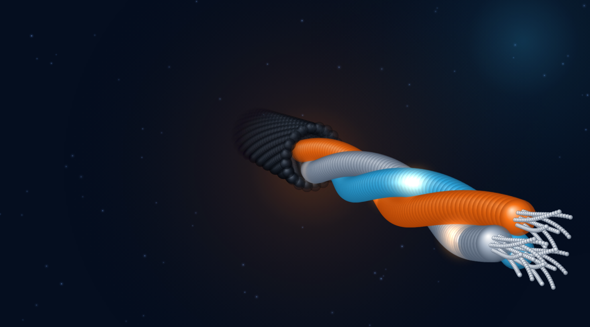

# Alum Cable Kaveh — Corporate Website (Demo)

A trilingual (Persian / English / Arabic, RTL + LTR) corporate website for an
industrial cable manufacturer: product catalogue, technical reference tables,
datasheet requests, a contact form and a small admin inbox.

> **Demo / portfolio project.** Articles on the news pages are sample content.
> Company contact details live in one file (`lib/site.ts`) and can be overridden
> with environment variables, so a public demo never has to show real data.


<sub>The hero is a dependency-free 3D scene (Canvas 2D): a three-core cable with
twisted insulated cores, bare aluminium strands and current pulses. Source:
[`lib/cable-scene.ts`](lib/cable-scene.ts).</sub>

## Features

- **i18n** — FA / EN / AR with RTL/LTR handling; the visitor's choice is remembered
- **Product catalogue** — PostgreSQL + Prisma (44 seeded cable types, 3 families, 3 languages)
- **Technical pages** — IEC / INSO / DIN / EN standard tables
- **Datasheet requests & contact form** — validated, rate-limited, honeypot-protected
- **Admin inbox** — JWT session cookie, read/unread, delete, pagination
- **3D hero animation** — no WebGL, no extra dependency; pauses off-screen, respects *reduced motion*
- **Security hardening** — see [`docs/SECURITY-AUDIT.md`](docs/SECURITY-AUDIT.md)

## Tech stack

Next.js 16 (App Router) · React 19 · TypeScript · Tailwind CSS 4 · Framer Motion ·
Prisma 5 · PostgreSQL 16 · jose (JWT) · bcrypt · zod · Leaflet / OpenStreetMap

## Quick start (local)

```bash
cp .env.example .env            # fill DATABASE_URL; JWT_SECRET is optional in dev
npm install                     # also runs `prisma generate`
npm run db:migrate              # create tables
npm run db:seed                 # cables, families, translations
npm run admin:create            # create your admin user (password prompt is hidden)
npm run dev                     # http://localhost:3000
```

Optional demo data (sample inbox + a demo admin): set `SEED_DEMO_DATA=true`,
`DEMO_ADMIN_EMAIL` and `DEMO_ADMIN_PASSWORD` (≥ 12 chars) before `npm run db:seed`.

## Scripts

| Command | What it does |
|---|---|
| `npm run dev` / `build` / `start` | Next.js dev server / production build / serve |
| `npm run check` | typecheck + lint + unit tests |
| `npm test` | unit tests (validation, rate limiting, CSRF/origin logic, body limits) |
| `npm run db:migrate` | `prisma migrate deploy` |
| `npm run db:seed` | seed catalogue (idempotent) |
| `npm run admin:create` | create / reset an admin (also revokes the admin's old sessions) |

## Project layout

```
app/                 pages + API routes (App Router)
  api/               contactUs, datasheet-request, products, health, admin/*
  admin/             login + inbox
  components/        Hero, Header, footer, sections, CableCanvas
lib/                 session, auth guard, validation (zod), rate-limit, http helpers, cable-scene (3D)
prisma/              schema, migrations, seed
scripts/             create-admin
tests/               unit tests (node:test + tsx)
docs/                DEPLOYMENT.fa.md, SECURITY-AUDIT.md
```

## Deploy

Docker Compose (PostgreSQL + app) is included — step-by-step guide in
[`docs/DEPLOYMENT.fa.md`](docs/DEPLOYMENT.fa.md) (Persian).

## License

MIT — see [LICENSE](./LICENSE).

## Author

Built by Mahsa Donyayi — https://www.linkedin.com/in/mahsa-donyayi
